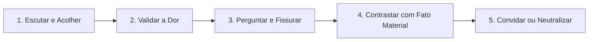

---
mocs:
  - "[[MOC_Politica]]"
  - "[[MOC_Eleicoes_2026]]"
tags:
  - metodologia
  - persuasao
  - comunicacao-politica
fontes:
  - "[[Fonte_Manual_da_Virada_e_Analise_Filipe_Boni]]"
  - "https://www.youtube.com/watch?v=s8iF-GwNF8Y"
  - "https://www.dieese.org.br/notatecnica/2025/notaTec283salarioMinimo/3.html"
  - "https://www.tse.jus.br"
  - "https://www.gov.br/inss"
  - "https://g1.globo.com/globonews/jornal-globonews-edicao-das-10/video/moro-diz-que-governo-dilma-tinha-crimes-gigantescos-mas-que-manteve-autonomia-da-pf-8507289.ghtml"
status: em-estudo
atualizado: 2026-11-02
---

# Método da Conversa Política em Cinco Tempos

## Resumo Feynman (Minhas Palavras)

> [!note] Síntese Pessoal (Preencher após estudo ativo)
> *Explique aqui com suas próprias palavras a ideia central desta nota, sem jargões, e registre dúvidas ou contra-argumentos para testar depois.*

Metodologia operacional de diálogo interpessoal e mobilização eleitoral desenhada para disputas majoritárias de margem estreita, convertendo os princípios de [[Psicologia_Escuta_e_Persuasao_Politica]] em um fluxo sequencial de cinco etapas, combinado à **flexibilidade tática** entre conversão direta, neutralização do voto adversário e redução de abstenção.

## Matemática Eleitoral de Margem Estreita e Flexibilidade Tática

Em eleições presidenciais decididas voto a voto — onde diferenças nacionais de poucos milhões de votos equivalem a uma margem média próxima de **4,5 votos por seção eleitoral (urna)** —, a ação microcapilar no círculo de convivência produz efeito aritmético direto sobre o saldo líquido. Como o contato pessoal privado possui **13 vezes mais eficácia** que abordagens impessoais de rua ([[Fonte_Manual_da_Virada_e_Analise_Filipe_Boni]]; [análise de Filipe Boni no YouTube](https://www.youtube.com/watch?v=s8iF-GwNF8Y)), a estratégia adapta a meta ao grau de resistência do interlocutor:

| Ação Estratégica no Diálogo | Mecanismo Eleitoral | Impacto Líquido no Placar |
| :--- | :--- | :--- |
| **Conversão direta de voto** (ex: de Flávio Bolsonaro para Lula) | Retira 1 voto do adversário e soma 1 voto ao campo progressista | **+2 votos** |
| **Neutralização tática** (eleitor adversário irredutível que decide anular, votar em branco ou abster-se) | Retira 1 voto ativo da candidatura de desmonte social quando a conversão direta é inviável | **+1 voto** |
| **Mobilização antiabstenção** (levar à urna abstencionistas do 1º turno ou eleitores com voto facultativo 70+) | Converte preferência latente majoritariamente favorável em voto computado | **+1 voto** |

## Estrutura Sequencial da Conversa em 5 Tempos

1. **Escutar e Acolher (sem julgar)**: Iniciar com perguntas abertas e genuínas sobre o cotidiano (*"Como está a vida por aí? O que está pesando mais no mês?"* ou *"O que você mais espera que mude nos próximos anos?"*). A regra operacional exige deixar o interlocutor desabafar por **2 a 3 minutos sem interrupção**.
2. **Validar a Frustração Real**: Demonstrar empatia explícita diante da queixa apresentada (preço dos alimentos no supermercado, demora em filas do posto de saúde ou do INSS, cansaço da rotina), estabelecendo respeito mútuo antes de qualquer argumento.
3. **Perguntar para Fissurar Certezas**: Introduzir dúvida crítica sobre as consequências materiais do programa adversário por meio de perguntas não acusatórias (*"Você chegou a ver o que a equipe econômica de Flávio Bolsonaro planeja fazer nessa área?"* ou *"Sabia que a proposta inclui desvincular aposentadorias do salário mínimo e retomar a cobrança de combustíveis atrelada ao dólar?"*).
4. **Contrastar com Fato Material Verificado**: Conectar a preocupação específica do eleitor a dados concretos e fontes primárias:
   - **Custo de vida e emprego**: Demonstrar a soberania monetária brasileira, o colchão superior a 350 bilhões de dólares em reservas cambiais e o efeito recessivo da paralisação de obras sobre o comércio local ([[Arcabouco_Fiscal_Teto_de_Gastos_e_Ajuste_Recessivo]], [[Repertorio_Retorico_Previdencia_e_Corte_Social]]).
   - **Renda familiar e idosos**: Expor o impacto da desindexação previdenciária e do BPC frente à política de ganho real documentada na [Nota Técnica nº 283 do DIEESE](https://www.dieese.org.br/notatecnica/2025/notaTec283salarioMinimo/3.html) ([[Regra_Valorizacao_Salario_Minimo_Previdencia_e_BPC]]).
   - **Combustíveis e transporte**: Explicar o fim da Paridade de Preços de Importação (PPI) em maio de 2023 e o encarecimento regional gerado pela privatização de refinarias ([[Politica_Precos_Petrobras_PPI_e_Inflacao_de_Custos]], [[Repertorio_Retorico_Combustiveis_e_Custo_de_Vida]]).
   - **Ética pública e instituições**: Mobilizar a demissão de Sérgio Moro em 2020 e seu [depoimento em vídeo na GloboNews](https://g1.globo.com/globonews/jornal-globonews-edicao-das-10/video/moro-diz-que-governo-dilma-tinha-crimes-gigantescos-mas-que-manteve-autonomia-da-pf-8507289.ghtml) atestando a autonomia da Polícia Federal nos governos do PT, em contraste com cinco trocas no comando da PF sob Jair Bolsonaro para blindar investigações no Rio de Janeiro ([[Autonomia_Policia_Federal_e_Mecanismos_Anticorrupcao]]).
   - **Sistema financeiro e desinformação**: Apresentar as 96 mensagens periciadas pela PF entre Flávio Bolsonaro e o banqueiro Daniel Vorcaro e o desmentido oficial da PF, da PGR e da defesa do banqueiro contra o áudio forjado sobre Lula ([[Rede_Politica_Caso_Banco_Master_e_Desinformacao_2026]], [[Repertorio_Retorico_Corrupcao_e_Caso_Master]]).
5. **Convidar ou Neutralizar (Fechamento)**:
   - **Cenário de Abertura (Conversão)**: Reconhecer que a conjuntura não é perfeita, mas convidar ao voto para preservar o salário valorizado e a capacidade democrática de cobrança.
   - **Cenário de Antipetismo Irredutível (Neutralização)**: Respeitar a rejeição partidária do interlocutor e apelar à coerência moral para que **anule, vote em branco ou não compareça**, evitando endossar cortes previdenciários e aparelhamento policial.

## Públicos Prioritários de Mobilização

- **Idosos (70 anos ou mais — voto facultativo)**: Contingente de **17,2 milhões de eleitores**, dos quais quase **10 milhões** deixaram de comparecer em 2022, faixa etária com ampla vantagem progressista. Três incentivos práticos reduzem barreiras logísticas:
  1. Ausência no 1º turno **não impede o voto no 2º turno**, sem cobrança de multa ou bloqueio imediato.
  2. O registro biométrico na urna eletrônica vale como **Prova de Vida automática junto ao INSS**, conforme a [Portaria MPS nº 723](https://www.gov.br/inss).
  3. O transporte coletivo urbano e intermunicipal é **100% gratuito por determinação legal** no dia do pleito, nos termos da [Resolução TSE nº 23.736/2024](https://www.tse.jus.br).
- **Trabalhadores com renda de até 2 salários mínimos**: Segmento com vantagem histórica superior a 20 pontos percentuais para candidaturas trabalhistas, cujo principal obstáculo não é divergência programática, mas **cansaço físico da rotina, desânimo e custo/dificuldade de deslocamento**.
- **Eleitorado fatigado da polarização**: Sensível a argumentos de previsibilidade institucional, pacificação familiar e proteção de serviços públicos essenciais contra crises políticas permanentes.

## Rotina Diária de 15 Minutos e Plano de Voto em 5 Perguntas

A atuação cotidiana dispensa longas reuniões presenciais quando organizada em dois protocolos comportamentais de baixa fricção:

- **Rotina de 15 Minutos Diários**:
  1. Selecionar **3 pessoas do convívio direto** (parente, colega de trabalho, amigo de infância).
  2. Iniciar contato leve no WhatsApp privado (*"Estava pensando na eleição... posso saber o que você está achando?"*).
  3. Conduzir a escuta ativa seguindo os cinco tempos.
  4. Enviar link curto ou evidência documental **apenas se o contato demonstrar abertura**.
- **Plano de Voto em 5 Perguntas (72 Horas Finais)**: Técnica de intenção de implementação aplicada nos três dias anteriores à votação para converter intenção declarada em comparecimento real:
  1. **Onde?** Conferência prévia do local e eventual mudança de seção no aplicativo e-Título ou portal do [TSE](https://www.tse.jus.br).
  2. **Que horas?** Definição de horário específico (ex: compromisso às 9h da manhã) em vez de postergação indefinida.
  3. **Como vai?** Uso da gratuidade universal de ônibus/vans públicas (Resolução TSE nº 23.736/2024) ou oferta de carona solidária.
  4. **Com quem?** Deslocamento acompanhado por familiares, idosos ou vizinhos, reduzindo desistências de última hora.
  5. **Documento?** Verificação antecipada de documento oficial com foto (RG, CNH, Passaporte ou e-Título com biometria cadastrada).

> [!tip] Regra de Ouro na Execução Prática
> Priorize conversas individuais em canal privado, apoio logístico concreto a idosos e dados verificáveis; evite embates em grupos coletivos, compartilhamento de conteúdos não checados ou pressão agressiva sobre indecisos.
